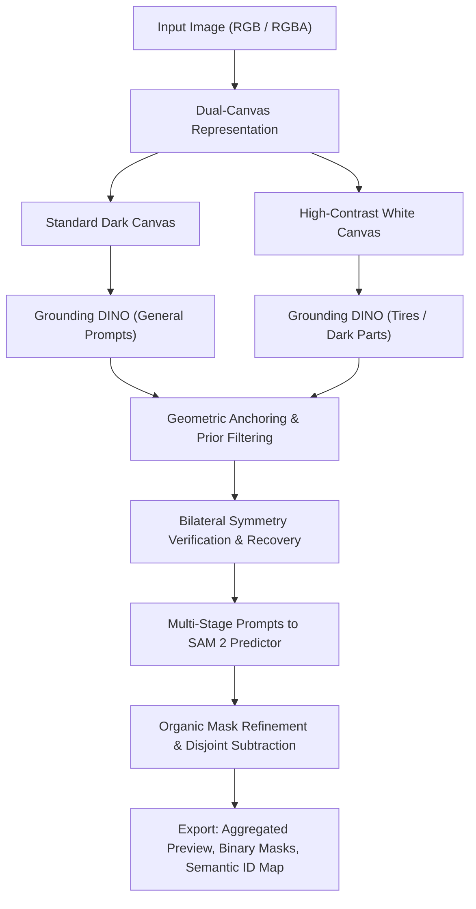

# Automated Multi-View Vehicle Semantic Part Segmentation

[](https://www.python.org/downloads/release/python-3100/)
[](https://pytorch.org/)
[](https://github.com/facebookresearch/segment-anything-2)
[](https://github.com/IDEA-Research/GroundingDINO)
[](https://zenodo.org/records/24309595)

> [!IMPORTANT]
> **Reference Paper:**  
> This repository provides the official implementation of the car part segmentation method used in the paper:  
> **COMING SOON**
>
> **Associated Dataset:**  
> The dataset referenced in the paper is openly available on Zenodo:  
> [**https://zenodo.org/records/24309595**](https://zenodo.org/records/24309595)

---

## 📌 Overview

This repository provides an automated, fine-grained semantic part segmentation pipeline designed for multi-view vehicle photographs across **Front**, **Lateral (Side-Profile)** and **Rear** perspectives.

Traditional semantic segmentation models require extensive pixel-level annotations for training. In contrast, this framework leverages foundation vision models, coupling **Grounding DINO** (open-vocabulary bounding box detection) with **Segment Anything 2 (SAM 2)** (zero-shot promptable segmentation), enhanced by **domain-specific automotive geometric priors**, **bilateral symmetry constraints** and **multi-stage organic mask refinement**.

### Key Technical Capabilities

- **Multi-View Coverage:** Dedicated pipelines for Front (12 semantic classes), Lateral (14 semantic classes) and Rear (10 semantic classes) automotive anatomy.
- **Dual-Pass Background Rendering:** Evaluates components on their natural/dark canvas while isolating tires and dark diffusers against an explicit high-contrast white canvas to prevent dark wheel-well blending.
- **Bilateral Symmetry Recovery:** Reconstructs unobserved or low-confidence components (headlights, taillights, side mirrors, wheels) across the vehicle's central longitudinal axis when occluded or under low contrast.
- **Spatial Hierarchy & Relative Constraints:** Enforces physical automotive relations (e.g., windshield above hood, mirrors bounded vertically between windshield top and hood bottom, doors positioned between wheel centers).
- **Organic Mask Splitting & Disjoint Partitioning:** Geometrically identifies window-sill lines to split merged door/window instances into distinct organic masks, subtracting handles and windows to guarantee mutually exclusive semantic partitions.
- **Automated Viewpoint Routing:** Includes zero-shot vision-language viewpoint classification via **CLIP** (`openai/clip-vit-base-patch32`) for end-to-end dataset processing without manual viewpoint tagging.

---

## 📁 Repository Structure

```text
car_segmentation_package/
├── checkpoints/                          # Pretrained neural network weights
│   ├── README.md                         # Checkpoint documentation and manual download links
│   └── .gitkeep                          # Preserves directory in git (weights are ignored)
│
├── GroundingDINO/                        # Grounding DINO submodule source tree
├── segment-anything-2/                   # Meta Segment Anything 2 submodule source tree
│
├── sample_data/                          # Minimal sample dataset for validation
│   └── IMAGE DATASET/
│       └── ECONOMICAL/DACIA/SANDERO 2021/
│           ├── front.png                 # Front perspective image
│           ├── lateral.png               # Lateral perspective image
│           └── rear.png                  # Rear perspective image
│
├── sample_results/                       # Pre-generated output demonstrations
│   └── ECONOMICAL/DACIA/SANDERO 2021/    # Segmented binary masks and aggregated overlays
│
├── frontSegmentator.py                   # Front-view segmentation pipeline
├── lateralSegmentator.py                 # Lateral-view segmentation pipeline
├── rearSegmentator.py                    # Rear-view segmentation pipeline
├── segment_3drealcar_custom_parts.py     # Unified orchestrator with CLIP viewpoint routing
│
├── download_weights.sh                   # Shell script to download model checkpoints
├── download_weights.py                   # Cross-platform Python script to download model checkpoints
├── setup_env.sh                          # Automated environment setup script
├── environment.yml                       # Conda environment specification
├── requirements.txt                      # Pip dependencies specification
├── .gitignore                            # Git ignore rules for checkpoints, outputs, and caches
└── README.md                             # Repository documentation
```

---

## 🎨 Granular Semantic Classes by Viewpoint

### 1. Front View (`frontSegmentator.py`)
Identifies 12 discrete automotive components from the front perspective:

| Class Key | Display Name | Color (BGR) | Description |
|:---|:---|:---:|:---|
| `car brand badge emblem` | Emblem | `(255, 0, 0)` | Front manufacturer logo or emblem |
| `car front windshield glass` | Windshield | `(0, 255, 0)` | Front windshield glass surface |
| `car hood` | Hood | `(0, 0, 255)` | Engine hood / bonnet panel |
| `car left side mirror` | Left Mirror | `(0, 255, 255)` | Left-hand lateral rearview mirror |
| `car right side mirror` | Right Mirror | `(255, 0, 255)` | Right-hand lateral rearview mirror |
| `car left headlight` | Left Headlight | `(255, 255, 0)` | Left primary front headlamp cluster |
| `car right headlight` | Right Headlight | `(0, 165, 255)` | Right primary front headlamp cluster |
| `car left front tire` | Left Tire | `(128, 0, 128)` | Left front tire contact patch |
| `car right front tire` | Right Tire | `(0, 128, 128)` | Right front tire contact patch |
| `car left lower bumper light` | Left Fog Light | `(100, 255, 100)` | Left fog light or lower DRL cluster |
| `car right lower bumper light` | Right Fog Light | `(200, 100, 255)` | Right fog light or lower DRL cluster |
| `car front grille` | Front Grille | `(20, 69, 139)` | Front radiator intake grille |

---

### 2. Lateral View (`lateralSegmentator.py`)
Identifies 14 discrete automotive components from the side profile:

| Class Key | Display Name | Color (BGR) | Description |
|:---|:---|:---:|:---|
| `front wheel` | Front Wheel | `(0, 255, 0)` | Front wheel rim and tire assembly |
| `rear wheel` | Rear Wheel | `(0, 0, 255)` | Rear wheel rim and tire assembly |
| `headlight` | Headlight | `(255, 255, 0)` | Lateral profile of the front headlight |
| `taillight` | Taillight | `(255, 0, 255)` | Lateral profile of the rear taillight |
| `rearview mirror` | Rearview Mirror | `(0, 165, 255)` | Side mirror assembly |
| `front door` | Front Door | `(255, 140, 0)` | Front door body panel (excluding glass & handle) |
| `rear door` | Rear Door | `(128, 255, 0)` | Rear door body panel (excluding glass & handle) |
| `front door window` | Front Door Window | `(255, 215, 0)` | Front door side window glass |
| `rear door window` | Rear Door Window | `(0, 191, 255)` | Rear door side window glass |
| `front door handle` | Front Door Handle | `(147, 20, 255)` | Front exterior door handle |
| `rear door handle` | Rear Door Handle | `(20, 147, 255)` | Rear exterior door handle |
| `fuel door` | Fuel Door | `(40, 40, 40)` | Fuel filler flap or charging port door |
| `front bumper` | Front Bumper | `(128, 0, 128)` | Side profile of the front bumper fascia |
| `rear bumper` | Rear Bumper | `(0, 128, 128)` | Side profile of the rear bumper fascia |

---

### 3. Rear View (`rearSegmentator.py`)
Identifies 10 discrete automotive components from the rear perspective:

| Class Key | Display Name | Color (BGR) | Description |
|:---|:---|:---:|:---|
| `rear windshield` | Rear Windshield | `(0, 255, 0)` | Rear window / tailgate glass |
| `logo` | Logo | `(0, 0, 255)` | Rear manufacturer badge or model wordmark |
| `left mirror` | Left Mirror | `(0, 255, 255)` | Left side mirror visible from rear |
| `right mirror` | Right Mirror | `(255, 255, 0)` | Right side mirror visible from rear |
| `left taillight` | Left Taillight | `(255, 0, 255)` | Left taillight (or left segment of lightbar) |
| `right taillight` | Right Taillight | `(255, 128, 255)` | Right taillight (or right segment of lightbar) |
| `left wheel` | Left Wheel | `(128, 0, 128)` | Left rear tire contact patch |
| `right wheel` | Right Wheel | `(0, 128, 128)` | Right rear tire contact patch |
| `exhaust tips` | Exhaust Tips | `(255, 0, 0)` | Exhaust tailpipe outlets (central or lateral) |
| `rear bumper` | Rear Bumper | `(0, 128, 128)` | Rear bumper and lower diffuser assembly |

---

## ⚙️ Installation & Environment Setup

### System Prerequisites
- **Operating System:** Linux (Ubuntu 20.04/22.04 recommended), macOS or Windows 10/11.
- **Python:** Python 3.10 is strongly recommended.
- **Hardware:** NVIDIA GPU with at least 8 GB VRAM and CUDA 11.8 or 12.x support (CPU execution is supported as fallback).

---

### Option A: Setup with Conda (Recommended)

1. **Clone or navigate to the repository directory:**
   ```bash
   cd car_segmentation_package
   ```

2. **Create and activate the Conda environment:**
   ```bash
   conda env create -f environment.yml
   conda activate car_segmentation
   ```

3. **Install submodules in editable mode:**
   ```bash
   # On Linux / macOS:
   chmod +x setup_env.sh
   ./setup_env.sh

   # Or manually on Windows / any platform:
   pip install -e GroundingDINO --no-build-isolation
   pip install -e segment-anything-2 --no-build-isolation
   ```

---

### Option B: Setup with Standard Python Virtual Environment

1. **Create and activate a virtual environment:**
   ```bash
   python3 -m venv venv
   source venv/bin/activate       # On Linux / macOS
   # venv\Scripts\activate       # On Windows (cmd/PowerShell)
   ```

2. **Install PyTorch with CUDA support:**
   ```bash
   # Example for CUDA 11.8:
   pip install torch torchvision torchaudio --index-url https://download.pytorch.org/whl/cu118
   ```

3. **Install pip dependencies:**
   ```bash
   pip install -r requirements.txt
   ```

4. **Install submodules in editable mode:**
   ```bash
   pip install -e GroundingDINO --no-build-isolation
   pip install -e segment-anything-2 --no-build-isolation
   ```

---

## 📥 Pretrained Weights Download

The pipeline requires two pretrained weight checkpoints placed inside the `checkpoints/` directory:

1. **Grounding DINO Swin-T:** `checkpoints/groundingdino_swint_ogc.pth` (approx. 662 MB)
2. **SAM 2 Hiera Large:** `checkpoints/sam2_hiera_large.pt` (approx. 856 MB)

You can download them automatically using either of the provided scripts:

```bash
# Cross-platform Python downloader (recommended):
python download_weights.py

# Or via Bash (Linux / macOS / Git Bash):
chmod +x download_weights.sh
./download_weights.sh
```

Alternatively, download them manually from the official releases:
- [Grounding DINO Swin-T checkpoint](https://github.com/IDEA-Research/GroundingDINO/releases/download/v0.1.0-alpha/groundingdino_swint_ogc.pth)
- [SAM 2.0 Hiera Large checkpoint](https://dl.fbaipublicfiles.com/segment_anything_2/072824/sam2_hiera_large.pt)

---

## 🚗 Dataset Preparation & Folder Structure

Images to be segmented should be placed in an `IMAGE DATASET` directory located in the project root (a sample dataset is included in `sample_data/IMAGE DATASET`).

Recommended organizational hierarchy:
```text
IMAGE DATASET/
└── <CATEGORY>/
    └── <BRAND>/
        └── <MODEL_OR_ID>/
            ├── front.png      # Must contain 'front' in the filename
            ├── lateral.png    # Must contain 'lateral' in the filename
            └── rear.png       # Base filename must be 'rear'
```

Supported image extensions: `.png`, `.jpg`, `.jpeg`, `.bmp`, `.webp`.

> [!NOTE]
> If `IMAGE DATASET` is not found in the root directory, the scripts automatically fall back to `sample_data/IMAGE DATASET`.

---

## 🚀 Step-by-Step Usage Guide

### 1. Running Individual Viewpoint Segmentators

To segment images of a specific viewpoint, execute the corresponding dedicated script:

```bash
# 1. Front View Segmentation:
python frontSegmentator.py

# 2. Lateral (Side-Profile) View Segmentation:
python lateralSegmentator.py

# 3. Rear View Segmentation:
python rearSegmentator.py
```

Results will be automatically stored in the **`SEMANTIC_MASKS`** directory, maintaining the exact folder structure of the source dataset.

---

### 2. Running the Unified Multi-View Batch Pipeline

For large-scale dataset processing (e.g., 3DRealCar or unorganized photo collections), use the unified orchestrator `segment_3drealcar_custom_parts.py`. It automatically handles viewpoint classification, model loading, and multi-format exports.

```bash
python segment_3drealcar_custom_parts.py
```

#### Configuration Options (via Environment Variables)

You can customize the pipeline behavior without modifying code:

| Environment Variable | Default Value | Description |
|:---|:---:|:---|
| `3DREALCAR_DIR` | `./datasets/3DRealCar` | Base path to dataset images |
| `OUTPUT_MASKS_FOLDER` | `./SEMANTIC_MASKS_OUTPUT_3DREALCAR_CUSTOM` | Directory for binary masks and ID maps |
| `OUTPUT_OVERLAYS_FOLDER`| `./SEMANTIC_OVERLAYS_OUTPUT_3DREALCAR_CUSTOM` | Directory for aggregated color preview overlays |
| `FORCE_VIEW` | `""` | Bypass CLIP and force a specific viewpoint (`front`, `lateral`, or `rear`) |
| `USE_VIEW_ROUTING` | `1` | Enable zero-shot CLIP viewpoint classification |
| `DATA_SPLITS` | `"val"` | Dataset sub-splits to process (comma-separated, e.g. `"train,val"`) |
| `MAX_IMAGES_PER_SPLIT` | `0` (all) | Limit maximum processed images per split for quick evaluation |
| `BOX_THRESHOLD` | `0.25` | Grounding DINO bounding box confidence threshold |
| `TEXT_THRESHOLD` | `0.20` | Grounding DINO text alignment threshold |
| `SAVE_OVERLAYS` | `1` | Save high-resolution blended color overlays |
| `SAVE_LABEL_MAP` | `1` | Save 2D integer semantic label maps (`semantic_custom_ids.png`) |
| `SAVE_METADATA` | `1` | Save per-image JSON metadata (`metadata.json`) |

**Examples:**

```bash
# Force lateral view and process only the first 50 images:
FORCE_VIEW=lateral MAX_IMAGES_PER_SPLIT=50 python segment_3drealcar_custom_parts.py

# Process custom dataset folder:
3DREALCAR_DIR=/path/to/my_cars python segment_3drealcar_custom_parts.py
```

---

## 📊 Output File Formats

For each processed vehicle image, the output directory contains:

1. **Aggregated Color Overlay (`{view}_aggregated.png`):**
   - High-resolution composite image with all detected semantic masks blended onto a softened background.
   - Includes a color-coded legend column rendered on the right margin showing all active classes.
2. **Individual Binary Masks (`{class_name}.png`, e.g., `car_hood.png`, `front_door.png`):**
   - Pure 8-bit single-channel binary masks ($255 = \text{component}$, $0 = \text{background}$).
   - Ideal for computing Intersection over Union (IoU), visual saliency analysis, or training downstream models.
3. **Integer Semantic Label Map (`semantic_custom_ids.png`):**
   - Single-channel 8-bit map where pixel values correspond directly to custom class IDs ($0 = \text{background}$, $1\dots 49 = \text{classes}$).
4. **Structured Metadata (`metadata.json`):**
   - Records source path, detected viewpoint, classification confidence, class IDs, mask filenames, and exact pixel coverage counts.

---

## 🔬 Algorithmic Details & Innovations



1. **Dual-Canvas Representation:**
   Vehicle wheels and lower aerodynamic diffusers often share dark tones with shadows and studio backdrops. Processing tires on a synthetic white canvas exposes clear boundary contours to the detection and segmentation heads.
2. **Geometric Constraints & Relative Bounding:**
   Bounding boxes are filtered against relative spatial priors rather than absolute pixel coordinates, accommodating varying vehicle distances, focal lengths, and camera elevations.
3. **Bilateral Symmetry Enforcement:**
   Cars exhibit strong bilateral symmetry. If detection fails on one side (e.g. shadowed headlight or occluded side mirror), the system mirrors the verified candidate across the central longitudinal vehicle axis.
4. **Organic Door & Window Refinement:**
   When SAM 2 merges side window glass into the door panel, the module performs horizontal density profiling to detect the window sill inflection point, creating discrete bounding boxes to prompt SAM 2 independently for the window and door.

---

## 📖 Citation

If you find this work, repository, or method useful for your research, please cite our paper:

```bibtex
@article{comingsoon_car_segmentation,
  title={COMING SOON},
  author={COMING SOON},
  journal={COMING SOON},
  year={COMING SOON}
}
```

Please also cite the associated dataset available on Zenodo:

```bibtex
@dataset{notaro_2026_24309595,
  author       = {Notaro, Fabio and
                  FRANCO, ANNALISA and
                  BORGHI, GUIDO and
                  Vezzani, Roberto},
  title        = {CarGaze},
  month        = nov,
  year         = 2026,
  publisher    = {Zenodo},
  doi          = {10.5281/zenodo.24309595},
  url          = {https://doi.org/10.5281/zenodo.24309595},
}
```

### Acknowledgements & Third-Party Works

This pipeline builds upon foundational research in open-vocabulary detection and promptable segmentation:
- **Grounding DINO:** Liu et al., *"Grounding DINO: Marrying DINO with Grounded Pre-Training for Open-Set Object Detection"*, [arXiv:2303.05499](https://arxiv.org/abs/2303.05499).
- **Segment Anything 2 (SAM 2):** Ravi et al., *"SAM 2: Segment Anything in Images and Videos"*, [arXiv:2408.00714](https://arxiv.org/abs/2408.00714).
- **CLIP:** Radford et al., *"Learning Transferable Visual Models From Natural Language Supervision"*, [arXiv:2103.00020](https://arxiv.org/abs/2103.00020).

---

## 📜 License

This project is licensed under the Apache 2.0 License. Submodules `GroundingDINO` and `segment-anything-2` are subject to their respective open-source licenses.
